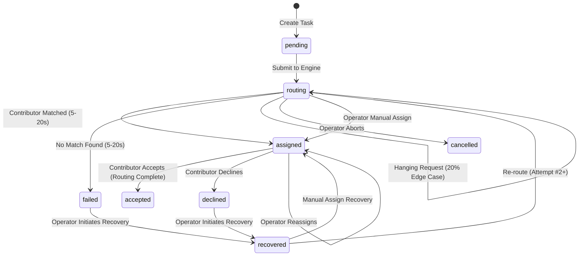

# ⚡ Contributor Task Routing System & Operator Control Center

[](https://www.typescriptlang.org/)
[](https://react.dev/)
[](https://expressjs.com/)
[](https://sqlite.org/)
[](https://tailwindcss.com/)
[](https://github.com/HarnishSavsani/contributor-routing-system)
[](https://github.com/HarnishSavsani/contributor-routing-system)

> A reactive, human-in-the-loop task routing engine that automatically matches specialized tasks to skilled contributors, while empowering operators with real-time observability, race-condition safeguards, and recovery interventions for unresolved hanging requests.

---

## 📌 Table of Contents

- [🌟 System Overview](#-system-overview)
- [🧩 Problem & Domain Modeling](#-problem--domain-modeling)
- [⚙️ Routing Engine Mechanics](#️-routing-engine-mechanics)
  - [⏱️ 5–20s Matching Window](#️-520s-matching-window)
  - [⚠️ 20% Unresolved Request Edge Case](#️-20-unresolved-request-edge-case)
  - [🛡️ Late-Response & Race Condition Safeguards](#️-late-response--race-condition-safeguards)
  - [🔄 System Restart & Recovery Reconciliation](#-system-restart--recovery-reconciliation)
- [🎛️ Operator Capabilities & Human-in-the-Loop Control](#️-operator-capabilities--human-in-the-loop-control)
- [🎨 Minimalist Shadcn UI/UX & Dual Themes](#-minimalist-shadcn-uiux--dual-themes)
- [🏗️ System Architecture](#️-system-architecture)
- [🚀 Quick Start & Installation](#-quick-start--installation)
- [🧪 Automated Test Suite](#-automated-test-suite)
- [📡 API & Real-time Stream Specification](#-api--real-time-stream-specification)

---

## 🌟 System Overview

In research and knowledge work, matching requests to the right domain specialists requires coordinating **automated background routing** with **human operational judgment**. Automated workers can fail, hang indefinitely, or deliver delayed responses, while contributors may decline assignments due to capacity constraints.

This system demonstrates a complete full-stack solution featuring:
- **Asynchronous Background Routing Engine**: Matches tasks to contributors based on certified expertise areas with realistic timing delays and probabilistic hanging request simulation.
- **Strict Invariants**: Enforces **at most one active assignee per task**. Contributor acceptance finalizes routing permanently.
- **Human-in-the-Loop Observability**: Real-time push updates via **Server-Sent Events (SSE)**, with live ticking timers and zero-refresh UI.
- **Proactive Intervention & Recovery**: Intervene mid-flight (manual assignment, cancellation, force re-routing) or recover tasks from failed/declined states.
- **Immutable Audit Trail**: Detailed timeline capturing every state transition, actor identity, duration, and metadata.

---

## 🧩 Problem & Domain Modeling

### 🏷️ Expertise Areas
Pre-configured with standard knowledge domains:
- `Finance` • `Healthcare` • `Data Analysis` • `Operations` • `Legal` • `Security` *(plus custom ad-hoc tags)*.

### 👥 Contributors
Each contributor possesses one or more verified expertise tags (e.g., Dr. Elena Vance: Healthcare & Operations; Marcus Sterling: Finance & Data Analysis).
- Tracks `status` (`available` / `busy`), active task capacity, and current assignment workload.

### 📋 Tasks & State Machine
Every task progresses through an explicit, auditable finite state machine:



---

## ⚙️ Routing Engine Mechanics

### ⏱️ 5–20s Matching Window
When submitted, a background routing job is dispatched asynchronously. Normal requests simulate a realistic remote worker search window randomly distributed between **5,000 ms and 20,000 ms** (5–20 seconds).
- The engine filters contributors whose certified expertise matches `task.expertiseRequired`.
- If one or more eligible candidates exist, one is selected and assigned.
- If no eligible candidates exist (e.g., task requires an unstaffed skill), the engine transitions to `failed` (`action: NO_MATCH_FOUND`).

### ⚠️ 20% Unresolved Request Edge Case
To mirror real-world distributed networks where background workers drop connections silently without throwing errors:
- **Exactly 20% of routing requests simulate an unresolved hang.**
- The request neither errors nor finishes automatically.
- **Authentic Operational Uncertainty**: Per real-world conditions, the engine does not artificially announce that a pending task is doomed to hang. Instead, the operator observes the live elapsed timer. When elapsed time crosses the standard **20-second threshold**, the UI provides an operational hint recommending human intervention.
- The top navigation bar includes a **"Simulate Stuck (20%)"** action button to trigger this edge case deterministically for demonstrations.

### 🛡️ Late-Response & Race Condition Safeguards
A critical distributed edge case occurs when an operator intervenes while routing is still pending, but the background worker returns afterward:
- **Human Precedence Guarantee**: When the delayed background worker eventually returns, the engine checks whether the task state was modified by a human operator.
- If the operator manually assigned or cancelled the task, the late-arriving automated assignment is **safely discarded** without overwriting human decisions.
- A `ROUTING_RESULT_DISCARDED` audit event is logged in the task timeline, capturing the discarded candidate and proving race-condition resilience.

### 🔄 System Restart & Recovery Reconciliation
If the server crashes, reboots, or is restarted while background requests are pending:
- On startup, `routingEngine.reconcileOnStartup()` scans SQLite for active `routing` tasks.
- Hanging requests (20% edge case) are safely restored in `routing` state awaiting operator review.
- Normal pending jobs have their elapsed time calculated: if the window passed during downtime, they resolve immediately; if time remains, background timers resume with the exact remaining delta.
- Logged under `SYSTEM_RESTART_RECONCILED` in the immutable audit trail.

---

## 🎛️ Operator Capabilities & Human-in-the-Loop Control

| Operator Action | Description | Audit Action Logged |
| :--- | :--- | :--- |
| **Create & Submit** | Define task parameters and queue for matching. | `TASK_CREATED` |
| **Manual Assignment** | Directly assign any specialist (matches skill or logs human override). | `OPERATOR_MANUAL_ASSIGN` |
| **Cancel / Abort** | Immediately stops background matching; sets state to `cancelled`. | `OPERATOR_CANCEL_ROUTING` |
| **Force Re-route** | Discards stuck/slow search and re-starts a fresh matching attempt. | `OPERATOR_FORCE_REROUTE` |
| **Recover Task** | Recovers tasks from `failed` or `declined` states to route again or assign. | `OPERATOR_RECOVER` |
| **Simulate Contributor** | Simulate contributor `Accept` (finalizes routing) or `Decline` (triggers recovery). | `CONTRIBUTOR_ACCEPTED` / `DECLINED` |
| **Inspect Audit Log** | Review complete chronological history, actor tags, timestamps, and metadata. | View `TaskHistoryEntry[]` |

---

## 🎨 Minimalist Shadcn UI/UX & Dual Themes

The user interface follows the minimalist **Shadcn** design system:
- **☀️ Light & 🌙 Dark Mode**: System-aware with instant toggle in the navbar, persisting via `localStorage`.
- **Dual View Modes**:
  - **Card Grid View**: Rich visual cards with state indicators, contributor avatars, and live ticking timers.
  - **Dense Data Table View**: High-density operational data table with inline action buttons for power users.
- **Real-Time Reactive Streaming**: Powered by Server-Sent Events (SSE); zero browser refresh required.
- **Audit Log Inspector**: Clean vertical timeline dialog featuring actor identity badges (`Bot`, `UserCheck`, `User`, `Cpu`), state delta chips, and formatted JSON metadata.

---

## 🏗️ System Architecture

```
┌─────────────────────────────────────────────────────────────┐
│                       React 19 Frontend                     │
│  (Vite + Tailwind CSS v4 + Lucide Icons + Shadcn Tokens)    │
└──────────────────────────────▲──────────────────────────────┘
                               │ HTTP REST & SSE (/api/events)
┌──────────────────────────────▼──────────────────────────────┐
│                    Express.js Backend API                   │
│  - Task & Contributor State Machine Controller             │
│  - Background Routing Engine (5–20s window + 20% hang sim)  │
│  - EventStreamManager (Real-time SSE Broadcaster)           │
│  - Startup Reconciler (Reboot & Crash Recovery)             │
└──────────────────────────────▲──────────────────────────────┘
                               │ WAL-Mode SQLite Queries
┌──────────────────────────────▼──────────────────────────────┐
│             Persistent SQLite Database Engine               │
│   (Node.js native DatabaseSync — Zero external dependencies)│
└─────────────────────────────────────────────────────────────┘
```

---

## 🚀 Quick Start & Installation

### Prerequisites
- **Node.js** (v18.0.0 or higher; v22/v26 recommended)
- **npm** (v9 or higher)

### 1. Clone & Install Dependencies
```bash
git clone https://github.com/HarnishSavsani/contributor-routing-system.git
cd contributor-routing-system
npm install
```

### 2. Build for Production
```bash
npm run build
```

### 3. Run Production Server
```bash
npm start
```
Visit **[http://localhost:3001](http://localhost:3001)** in your browser.

---

### 💻 Development Mode
To run client and server concurrently with Vite Hot Module Replacement (HMR):
```bash
npm run dev
```
- Frontend Dev Server: `http://localhost:5173` (proxied to backend)
- Backend API Server: `http://localhost:3001`

---

## 🧪 Automated Test Suite

A comprehensive 17-point test suite validates all requirements, edge cases, and state transitions using Node's native test runner (`node:test`):

```bash
npm test
```

### Tested Scenarios
- [x] Initial database seeds and contributor expertise mappings
- [x] Normal background routing matching eligible contributors (5–20s window)
- [x] No-match failure handling when no contributors match expertise
- [x] 20% hanging edge case simulation (request stays stuck indefinitely until intervention)
- [x] Operator intervention during routing (manual assignment override)
- [x] Operator intervention during routing (cancelling/aborting routing)
- [x] Contributor acceptance flow finalizing routing
- [x] Contributor decline flow clearing assignee and enabling operator recovery
- [x] Full audit log and chronological timeline integrity
- [x] REST API endpoints (`/api/tasks`, `/api/contributors`, `/api/stats`, `/api/simulation/config`)
- [x] Server-Sent Events (SSE) connectivity and broadcast delivery

---

## 📡 API & Real-time Stream Specification

| Method | Endpoint | Description |
| :--- | :--- | :--- |
| `GET` | `/api/tasks` | Get all tasks (supports `?state=`, `?expertise=`, `?search=`). |
| `POST` | `/api/tasks` | Create a task (`title`, `description`, `expertiseRequired`, `autoRoute`, `forceStuck`). |
| `GET` | `/api/tasks/:id` | Get task details, active assignee profile, and complete history. |
| `POST` | `/api/tasks/:id/intervene` | Operator intervention (`manual_assign`, `cancel_routing`, `force_reroute`). |
| `POST` | `/api/tasks/:id/recover` | Recover failed/declined task (`reroute` or `manual`). |
| `POST` | `/api/tasks/:id/contributor-action` | Contributor simulation (`accept` or `decline`). |
| `GET` | `/api/tasks/:id/history` | Retrieve chronological audit trail entries. |
| `GET` | `/api/contributors` | List all registered specialists and active workloads. |
| `POST` | `/api/contributors` | Register or update a specialist profile. |
| `GET` | `/api/stats` | System metrics (total, in routing, stuck, assigned, accepted, needs recovery). |
| `GET` | `/api/simulation/config` | Inspect engine parameters (min/max window, stuck probability). |
| `POST` | `/api/simulation/config` | Update engine simulation parameters. |
| `POST` | `/api/system/seed-demo-routing` | Seed an instant live routing demo task (`normal` or `stuck`). |
| `POST` | `/api/system/reset` | Reset database to pristine 3-task canonical demo state. |
| `GET` | `/api/events` | Server-Sent Events (SSE) live push stream. |

---

## 📄 License

Distributed under the **MIT License**. See `LICENSE` for more information.
